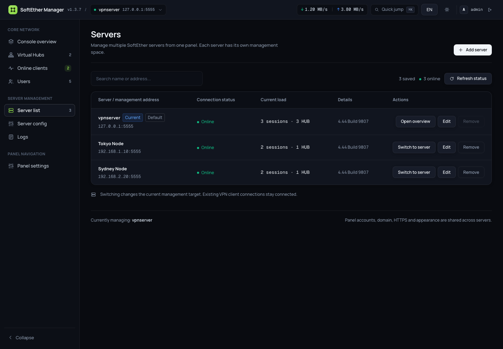
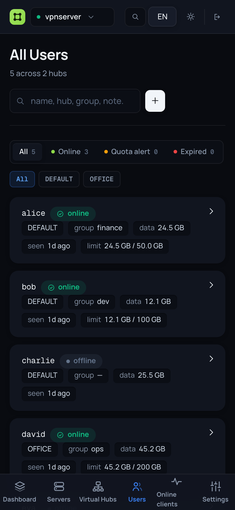
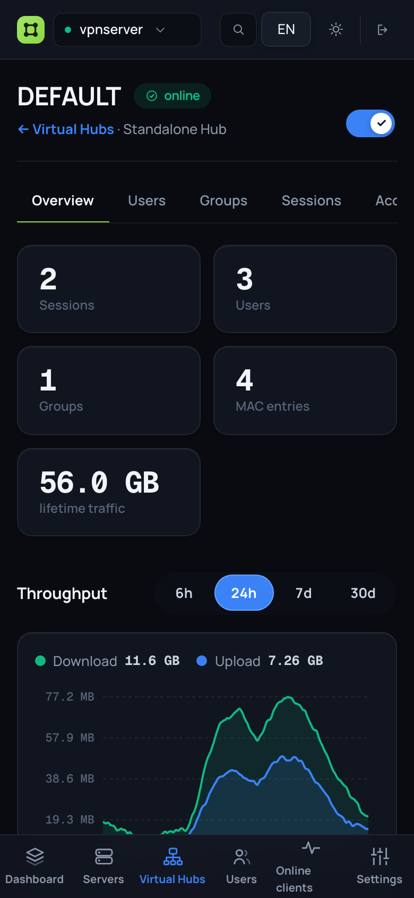

# SoftEther Manager

**English** | [简体中文](README.md) | [Latest release](https://github.com/siryle/Softether-Manager/releases/latest)

A modern, self-hosted web management panel for [SoftEther VPN Server](https://www.softether.org/).

> This project is modified and refactored from [DrSaeedHub/Softether-Manager](https://github.com/DrSaeedHub/Softether-Manager), designed specifically to manage servers running [SoftEther VPN](https://www.softether.org/).

Fully supports all 133 official SoftEther JSON-RPC management APIs, featuring a sleek modern UI, multi-server centralized switching, Linux kernel-level host monitoring (`/proc`), automated traffic quota enforcement with true counter zeroing, official **multi-arch Docker images**, and **LAN / remote server management**.

One command installs the panel beside your SoftEther instance. Everything after that —
users, policies, sessions, access control, SecureNAT, certificates, cascades, the works —
happens in the browser.


Previews use the current frontend build and a local mock management API. They contain
no real server or user data. This page shows the English interface; the [Chinese README](README.md)
uses its own Simplified Chinese previews.

## What it does

**Watches the machine.** The dashboard opens with the server's own health, read straight
from the kernel: CPU (with per-core detail, load, and steal time — the figure that
explains a slow VPS nothing else accounts for), memory and swap, every real filesystem,
and live network throughput, each with a few minutes of sparkline history.

**Switches between servers.** Save, edit, test and remove connections from the server
list. Search and switch from the compact 56px top bar or press `⌘K` to open the quick-jump
command palette for servers, hubs, and pages; each browser tab selects its own target.
The top bar also displays live host RX/TX throughput alongside server status.
Traffic, quotas, sessions, VPN credentials and audit records are isolated by server.
Panel accounts, domain and HTTPS settings are shared. Resource telemetry always
refers to the panel host. Release any enforced quotas before changing a server's
address, disabling it or removing its connection, so the panel can restore VPN access first.



**Manages SoftEther.** The panel is built on a complete client for the
SoftEther JSON-RPC suite, organised by where things
live:

| | |
| --- | --- |
| **Users** | Create, edit or delete users; filter by status (All / Online / Quota alert / Expired) or hub; manage passwords, certificates, RADIUS and NT authentication, groups, expiry, WireGuard peer keys, and per-user policies. Search users across hubs, download a `.vpn` connection file, or import and export CSV within a hub for anonymous or password accounts that can be restored without losing settings. |
| **Traffic limits** | a byte ceiling per config *and* per hub, counting download only, upload only, or both, in MB / GB / TB, measured against the very Transfer figure the tables show — reached, the panel denies the config's access and cuts its sessions (or takes the hub offline), and restores exactly what it found when the limit is raised or the transfer reset. SoftEther cannot zero a counter, so the panel keeps its own zero and every figure it prints subtracts it: **Reset transfer** really does put the column back to 0 B |
| **Groups** | create, edit, delete; group-wide security policy that members inherit |
| **Sessions & Clients** | aggregated Online Clients across all hubs and per-hub live sessions with client address, IP location/ISP, protocol, cipher, connection count (including active NAT TCP counts for L2TP/UDP sessions) and transfer; per-session detail with the session's own traffic curve; disconnect; and a session log that outlives the connection |
| **Access control** | the packet filter (priority, protocol, addresses, ports, users, delay/jitter/loss simulation) and the source-IP limit list |
| **Hub security** | trusted CA certificates, certificate revocation entries, RADIUS delegation, hub password |
| **SecureNAT** | enable/disable, virtual NAT and DHCP configuration, live NAT and lease tables |
| **Cascades** | hub-to-hub links to other servers, with live link status |
| **Switching** | MAC and IP address tables, local bridges, virtual layer-3 switches with interfaces and routes |
| **Server** | sticky section index across listeners, VPN-over-ICMP/DNS, WireGuard, L2TP/IPsec, OpenVPN and SSTP clones, VPN Azure, dynamic DNS status and hostname (enable or disable during VPN maintenance), cipher, certificate (view / replace / regenerate), clustering, keep-alive, syslog, a master-detail logs workbench, config backup and restore |
| **The panel itself** | a custom domain with a Let's Encrypt certificate the panel obtains and renews on its own, HTTPS on a port of your choosing, and a switch that makes the domain the only way in — a request by IP address gets a bare 404 |

**Draws what the numbers mean.** SoftEther keeps cumulative counters and no history, so
the panel samples them on a schedule and turns the deltas into throughput charts — per
hub, per user, and per session. Each user gets an identity card: who they are, how they
authenticate, what they've moved, whether they're online right now. Every sampler has
its own clock and its own switch in Settings, so a small box can keep the cheap ones and
turn the expensive ones off.


**Stops what has had enough.** Any config, and any hub, can carry a traffic ceiling: an
amount in MB, GB or TB, counting the download, the upload, or the two together. It is
measured against *the number already on screen* — the Transfer column — so a 300 GB
limit set on a config that has moved 144 GB starts at 144 GB, not at nothing. At the
ceiling the config is denied access and its sessions are cut, or the hub is taken
offline; the moment the limit is raised or the transfer reset, exactly the policy the
panel found is put back.

SoftEther counts forever and has no API to zero a counter, so the panel keeps its own
zero and every figure it prints subtracts it. **Reset transfer** moves that zero to
today, which puts the Transfer column and the limit back to nothing together — they
were never two numbers. A limit is edited where it belongs, on the config's profile,
and the user tables carry the meter so a full one is visible without opening anything.

**Says what state everything is in.** Every switch in the panel — a hub's online state, a
listener, SecureNAT, VPN Azure, a cascade, a layer-3 switch, a traffic limit — is a real
switch: it locks while the request is in flight, then shows the state *read back from the
server*, not the state that was clicked. A change that did not take says so, with the
reason, next to the control and in a toast.

More rooms of the house — every user across every hub, who is connected right now, one
Virtual Hub's home, and the whole thing in its light theme:


<details>
<summary><b>Virtual Hubs</b> — network segments and their users and sessions</summary>


</details>

<details>
<summary><b>Logs</b> — server files and paginated log content</summary>


</details>

<details>
<summary><b>Sessions</b> — who is connected, from where, over what, moving how much</summary>


</details>

<details>
<summary><b>Hub overview</b> — status, throughput, and the tabs where everything lives</summary>


</details>

<details>
<summary><b>Server settings</b> — listeners, protocols, encryption, bridges, L3 switches, clustering…</summary>


</details>

<details>
<summary><b>Light theme</b> — a first-class mirror, not an inversion</summary>


</details>

## The mobile panel

Below 960px the interface becomes a different application, not a squeezed one: a top bar
that knows where you are, a bottom tab bar, cards instead of tables, and bottom sheets
for decisions. Managing a VPN server from a phone is a first-class path.

<p align="center">
  
  
  
  
</p>

## Install

### Docker

The [multi-architecture image](https://github.com/siryle/Softether-Manager/pkgs/container/softether-manager)
supports Linux amd64 and arm64. Run `docker compose up -d` from the repository after
configuring the VPN management address and administrator credentials. See [DOCKER.md](DOCKER.md)
for same-host, LAN and container-to-container setups. Persist `/data` across upgrades.

### Native Linux (systemd)

On the Linux server that runs (or will run) SoftEther, as root:

```bash
bash <(curl -Ls https://raw.githubusercontent.com/siryle/Softether-Manager/master/scripts/install.sh)
```

The installer asks four questions — username, password, port, and a secret web path the
panel hides behind — and answers everything else itself: it downloads the native Go
executable for the host architecture, verifies its checksum, writes a
hardened systemd unit, creates your account before opening the listener, and confirms
the expected version is running. The default SQLite database is stored under
`/var/lib/softether-manager`. Back up the data directory and any SQLite database
configured outside it before upgrading.
Running the panel requires neither Python nor a Go compiler.

First sign-in, the panel asks for the SoftEther management port and administrator
password (127.0.0.1:5555 on a stock install), tests them, and connects. From then on it
is the server's control room.

Non-interactive, for automation:

```bash
read -r -s -p 'Panel password: ' sem_password
printf '\n'
printf '%s' "$sem_password" | bash <(curl -Ls https://raw.githubusercontent.com/siryle/Softether-Manager/master/scripts/install.sh) \
  --non-interactive --username admin --password-stdin --port 8443 --path mysecret --json
unset sem_password
```

Running the installer again on a host that already has the panel opens `sem`, the
management CLI, instead of reinstalling:

```
sem status               version, service state and the URL the panel is on
sem update               install the newest release
sem password             reset an account password when nobody can sign in
sem users                list the panel accounts
sem port / sem path      move the panel
sem domain               the domain, its certificate, and domain-only access
sem logs -f              follow the service log
sem uninstall            remove the panel (the database survives unless you say otherwise)
```

### Updating

The panel updates itself: the version pill in the corner checks the releases feed, and
one click installs the new version through the same installer an operator would use —
launched in a transient systemd unit so it survives the restart it performs. A release
that lands while the panel is open announces itself once, with the updater on the
notice. `sem update` does the identical thing from a shell.

### A domain and HTTPS

Set the certificate domain under **Current server configuration → Encryption & certificate**.
For HTTP-01, point DNS at the panel and make port 80 available to Let's Encrypt. For
Cloudflare DNS-01, provide a DNS API token and leave port 80 closed. Use a separate HTTPS
port if SoftEther already owns 443. The panel starts renewal 30 days before expiry and
stores the certificate and key in the data directory. Select an explicit VPN server if
you want automatic certificate deployment; failures are recorded and retried separately.

Once you are using the panel through the domain, **Only serve the panel at this domain**
turns away every request that arrives by IP address or under any other name, on every
port, with the same anonymous 404 the panel's root already gives. The switch is only
offered from the domain itself, so it cannot lock you out; requests from the machine
itself and the certificate validation path are always let through, so renewal and the
installer keep working. If a DNS change ever does strand you, `sem domain only off` on
the server lifts it.

## Scope

One panel manages one or more existing SoftEther servers, local or remote. Each browser
tab targets a single server. The dashboard always reports resources from the panel host;
VPN users, sessions, quotas, backups and history belong to the selected server. Backups
record the last success and error per server. Release any outstanding quota blocks before
restoring a VPN configuration. Use a full backup for authentication or policies that CSV
cannot carry.

## Architecture

```
/proc ────────┐
              ├──  Go net/http backend  →  Next.js panel
SoftEther ────┘    (internal/manager)       (app/web)
 JSON-RPC
```

One monolithic package, one process, one SQLite file:

- **`cmd/softether-manager/`** — the service and management CLI entry point.
- **`internal/manager/`** — the Go backend, using standard-library `net/http`.
  It shapes SoftEther JSON-RPC into the existing `/api/v1/` REST API, stores panel
  state using pure Go SQLite, samples resources, traffic and sessions, enforces
  quotas, manages certificates and updates, and serves the built frontend.
  RPC definitions are embedded in the executable.
- **`app/web/`** — the Next.js frontend, exported as a single hash-routed page so the
  same build serves from any secret path prefix. Dark and light themes, desktop and
  mobile shells.

Secrets stay where they belong: the SoftEther administrator password is
Fernet-encrypted in the database, as are reusable VPN user credentials; the session-signing and encryption keys are generated
on first start into the data directory, and so are the Let's Encrypt account key and the
panel's certificate; the environment file under `/etc` is readable only by root.
Browsers authenticate through HttpOnly cookies. Password changes invalidate old
sessions; signing out revokes that login across restarts. Eight failed login attempts
from the same source block further attempts for five minutes. Upgrading requires
signing in again, and existing VPN credentials are encrypted automatically. Keep the
database and `encryption.key` together; old backups may still contain plain credentials.

SoftEther management connections pin the certificate's SHA-256 fingerprint on first
use. A mismatch blocks administrator credentials before any HTTP request is sent.
When the panel installs a replacement, it updates the saved fingerprint automatically.
For replacements made outside the panel, use **Servers → Edit → Inspect saved server certificate**,
compare the fingerprint independently with the server, then confirm trust. Establish
the first connection over a trusted network. On isolated/self-signed setups you can opt
out per server with **Skip certificate verification (not recommended)** in the same form;
the administrator password is then sent to whatever answers on that address, and the
change is written to the audit log.

The Linux installer creates the account before opening the panel listener and passes
passwords through standard input. Its optional SoftEther installation uses pinned
`v4.44-9807-rtm` archives for amd64 and arm64, checked against recorded SHA-256 hashes
before unpacking or execution.

The embedded Go ACME client supports HTTP-01 and Cloudflare DNS-01 without Certbot or a cron job.

## Development

Use the Go version specified in `go.mod`, plus Node.js 22 and npm.

After cloning, run `git config --local core.hooksPath .githooks` once to enable
automatic version bumps on commit. Each commit with staged code changes follows a
decimal rollover rule (for example, `1.0.8 → 1.0.9 → 1.1.0`, `1.1.9 → 1.2.0`) in `VERSION`
and creates the matching Git tag. Auxiliary file edits (docs, screenshots, tests) skip
the bump, and explicitly staged version changes are always preserved.

```bash
go run ./cmd/softether-manager        # backend on :8000, serves app/web/out if built

# In another terminal:
cd app/web
npm ci
NEXT_PUBLIC_API_BASE=http://localhost:8000/ npm run dev   # point it at the backend
# Open http://localhost:3000 too: use the same hostname so cookies are shared.

npm test                             # server switching and configuration save behavior
npm run build                        # export frontend to app/web/out
cd ../..
go build -o softether-manager ./cmd/softether-manager
go test -race ./...
go vet ./...
python3 scripts/test-install.py
./softether-manager serve             # serve the backend and built frontend
```

The default data directory is `./data`; override it with `SEM_DATA_DIR`. Existing
`SEM_*` configuration and frontend API paths continue to work. Resource monitoring
reads Linux `/proc`; macOS development hosts report it as unavailable.

Backend tests use a local TLS stand-in for SoftEther, verify the legacy Python crypto
and VPN-file formats, and check persistence, quotas and the REST route contract.

Access-list replacements and deletions require the list's returned `version` in the
request JSON as `expected_version`. Stale versions return 409; missing versions return
428. Read the current list before writing it to avoid overwriting another tab's changes.

For the optional live VPN test, set `SEM_TEST_VPNSERVER_DIR` to a compiled official
SoftEther v4.44 directory containing `vpnserver` and `hamcore.se2`, then run
`go test -race ./internal/manager -run TestSoftEtherLiveQuotaReset -count=1`.
It starts two temporary servers and a real cascade session, checks that resets leave
the user and session unchanged, and verifies reconnection after quota cancellation.
The test is skipped when the variable is unset.

## Releases and previews

The release workflow builds one archive and its checksum. The archive contains Linux amd64
and arm64 binaries, the static frontend and the installer. Build it locally with
`bash scripts/build-release.sh --version vX.Y.Z`. Without an explicit version, packaging
uses the exact tag on HEAD or falls back to `VERSION`.

Pushing a new `VERSION` to the default branch creates its tag and dispatches the build.
Pushing a `vX.Y.Z` tag manually also starts a release. If the tag exists but the release
is missing, still a draft, or missing an asset, rerun **Auto Tag Release** from the default
branch in Actions. There is no need to delete or move the tag.

To refresh screenshots, run `npm --prefix app/web run build` and then
`node scripts/generate_screenshots.mjs`. The script needs `puppeteer` on the module path
(an isolated install via `NODE_PATH` works). Set `CHROME_PATH` to use an existing Chromium
binary. It writes separate image sets to `docs/screenshots/en/` and `docs/screenshots/zh-CN/`.

To upgrade from Python, stop the old service and back up the entire data directory,
then run the new installer or replace the container. Keep `manager.db`, `session.key`,
`encryption.key` and `tls/` together: existing accounts, encrypted connection details,
current-schema history, quotas and certificates retain their formats. Run only one
version against the database at a time. Single-server databases migrate transactionally while retaining accounts, credentials, quotas and history. Only early sample tables without hub names are rebuilt.

## Security notes

- Out of the box the panel serves plain HTTP. Configure a domain in the server certificate
  settings for Let's Encrypt, or put a TLS-terminating reverse proxy in front of the panel.
  For private administration, bind it to localhost and reach it over
  an SSH tunnel or WireGuard. A session issued over HTTPS carries a `Secure` cookie and is
  never sent back over the plain port.
- With a domain set, *Only serve the panel at this domain* refuses everything that does
  not name it — the bare IP address included — with an anonymous 404.
- The secret web path keeps scanners out of the login form; it is defence in depth, not
  authentication. The authentication is the account password (scrypt-hashed) and
  HttpOnly session cookies.
- Set `SEM_ADMIN_USERNAME` and `SEM_ADMIN_PASSWORD` before starting a public container.
  If left empty, whoever first completes setup can create the administrator account.
- The panel talks to SoftEther on the loopback interface by default, so the management
  password never crosses a network.

---

## 💡 Project Heritage & Acknowledgments

This project is tailored for managing **[SoftEther VPN](https://www.softether.org/)** servers, and is modified, significantly refactored, and expanded from **[DrSaeedHub/Softether-Manager](https://github.com/DrSaeedHub/Softether-Manager)**.

### 🌟 Projects Credited
- **Upstream Prototype**: [DrSaeedHub/Softether-Manager](https://github.com/DrSaeedHub/Softether-Manager) — Special thanks to DrSaeedHub for creating the original concept and initial design of SoftEther Manager.
- **Target VPN Server**: [SoftEther VPN Server](https://www.softether.org/) — Thanks to the SoftEther Project team and University of Tsukuba for creating and maintaining this versatile, high-performance open-source VPN server.

### 🛠️ Architecture Evolution & Key Differences

Based on the actual implementation of this codebase:

| Dimension | Original Prototype (DrSaeedHub) | This Project (Current Implementation) |
| :--- | :--- | :--- |
| **Backend Architecture** | Python 3 + FastAPI; requires Python runtime, pip dependencies, and virtual environment | **Rewritten entirely in pure Go** (standard library `net/http` + pure Go SQLite `modernc.org/sqlite`). Zero Python, Node.js, or CGO runtime dependencies. Minimal memory footprint, fast startup, single binary serving both Web API and CLI maintenance |
| **Server Management** | Manages only a single local SoftEther instance | **Multi-Server Management & Cluster Support**: Topbar search and instant switching between multiple SoftEther VPN server instances. Hubs, users, sessions, historical samples, traffic quotas, and credentials are fully isolated per server; safety checks enforce quota release before modifying/deleting servers |
| **Traffic Quotas** | Basic limit detection | **Baseline Offset "True Zeroing" Algorithm**: Solves the lack of a native counter-reset API in SoftEther. Resets bring visible transfer counters back to 0 B without breaking cumulative tracking. Denies access when the limit is reached and restores the saved policy when the limit is released |
| **Concurrency & Integrity** | No optimistic concurrency control | ACL updates and deletions use `expected_version`. Quota operations and management writes are serialized per server. |
| **Security Hardening** | Basic credential storage | **Defense-in-Depth**: Sensitive VPN credentials and password hashes encrypted with Fernet symmetric cipher in SQLite; scrypt password hashing for panel admins; `HttpOnly` / `SameSite=Lax` cookies (no tokens in `localStorage`); brute-force lockout after 8 consecutive failures |
| **TLS Verification** | Unpinned TLS connections | **TLS Certificate Pinning**: Records and pins SHA-256 fingerprints of the SoftEther JSON-RPC management interface upon first trust; refuses password transmission if certificates mismatch (MITM protection); visual fingerprint review and trust workflow |
| **Anti-Reconnaissance** | Standard web endpoints | **Stealth Mode**: Supports custom secret URL paths; optional "Domain-Only Access" returns anonymous 404 responses for any direct IP or unrecognized host header requests |
| **Automated SSL/TLS** | Manual certificate configuration | **Embedded ACME Client**: Supports Let's Encrypt HTTP-01 and Cloudflare DNS-01, and starts renewal 30 days before expiry. No Certbot or cron job. |
| **Packaging & Ops** | Source code installation | **Multi-Arch Docker & One-Line Installer**: Official multi-arch Docker image (`ghcr.io/siryle/softether-manager:latest` for amd64/arm64) supporting all LAN topologies; one-line Systemd installer with SHA-256 verified SoftEther 4.44 packaging and failure rollback; built-in `sem` CLI tool |
| **Frontend & i18n** | Basic SPA | **Next.js 15 Modern SPA**: Full Dark/Light themes, instant real-time Chinese/English toggle without page reload, mobile-responsive layout (<960px switches to native app experience with bottom navigation and sheets), faithful chart rendering with gap preservation |

---

## 📄 License & Attribution

- This project consists of a newly developed pure Go backend and a deeply refactored frontend. All new and modified code is licensed under the [MIT License](https://opensource.org/licenses/MIT).
- The early architectural prototype originated from [DrSaeedHub/Softether-Manager](https://github.com/DrSaeedHub/Softether-Manager); relevant component designs retain original copyright (Copyright (c) 2024 Seyed Saeed Sadri).
- This is an independent self-hosted management console and is not affiliated with or endorsed by the [SoftEther Project / SoftEther VPN](https://www.softether.org/) or the University of Tsukuba. SoftEther VPN is a registered trademark of the SoftEther Project / University of Tsukuba.
